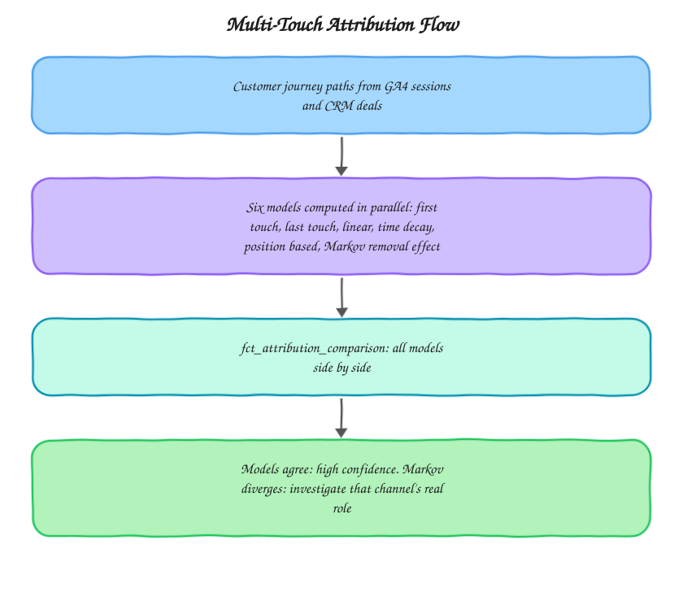

# Attribution Modeling Toolkit

Multi-touch attribution models built in SQL and Python so a customer journey can be evaluated by more than one lens before a business commits to which channel gets the credit. Built around the kind of attribution work I do at [motabar.builds.stuff](https://motabar.builds.stuff).

## The problem this solves

Every ad platform grades its own homework. Google Ads takes credit on a last-click basis, Meta takes credit on its own attribution window, and neither agrees with the other or with what actually happened in the customer's journey. Most businesses either trust whichever platform's number is most convenient, or default to GA4's last-click model without realizing that's a choice with real consequences, channels that open the funnel (like organic content or paid social) systematically look worthless under last-click, which leads to cutting the exact channels that were generating demand in the first place.

## Architecture

The reason six models exist here rather than picking one is deliberate. Rule based models (first touch, last touch, linear, time decay, position based) are fast and explainable but arbitrary, someone decided the weighting. The Markov chain model is data driven, it measures each channel's actual removal effect, how much conversion probability drops when that channel is taken out of the observed paths, but it's a black box that's harder to explain to a stakeholder in one sentence. Running both side by side is more honest than picking one and presenting it as ground truth.

## What's in here

* `sql/first_last_touch_attribution.sql` builds first touch and last touch credit assignment from GA4 session paths joined to CRM closed deals
* `sql/linear_time_decay_attribution.sql` implements linear (equal credit) and time decay (exponentially weighted toward the touch closest to conversion) models
* `python/markov_chain_attribution.py` computes the Markov chain removal effect model, the data driven approach that measures each channel's actual marginal contribution rather than applying a fixed rule
* `dbt_models/fct_attribution_comparison.sql` brings all model outputs together into one table so channel credit can be compared side by side per model

## How it's used in practice

The customer journey path is built once, a single query rebuilding the ordered sequence of channel touches for every user who eventually converted, and every rule-based model in `sql/` reads from that same path rather than rebuilding it, which keeps the models genuinely comparable instead of each working from a slightly different definition of "the journey." The Markov model works from the same paths but treats them as a graph rather than a sequence: it builds transition probabilities between channels and the conversion or non-conversion state, then measures what happens to overall conversion probability when each channel is removed from every path it appeared in.

## Reading the comparison output

When first touch and last touch disagree sharply on a channel, that's not a bug, it usually means the channel plays a specific role in the funnel (either opening it or closing it) rather than driving the whole journey. When the Markov removal effect disagrees with all the rule-based models on a channel's importance, that's the more interesting signal, it usually means the channel's real value isn't well captured by position in the sequence, which is common for channels like retargeting that show up throughout a journey rather than at a fixed point.

## Setup

1. Build the customer journey path base query against your GA4 export and CRM closed deals table (schema referenced in `sql/first_last_touch_attribution.sql`)
2. Run the SQL models directly against BigQuery for the rule-based attribution values
3. Run `markov_chain_attribution.py` against an export of the same journey paths for the removal effect model
4. Load all outputs into `dbt_models/fct_attribution_comparison.sql` for the side by side view

## Stack

BigQuery, Python, dbt, SQL
